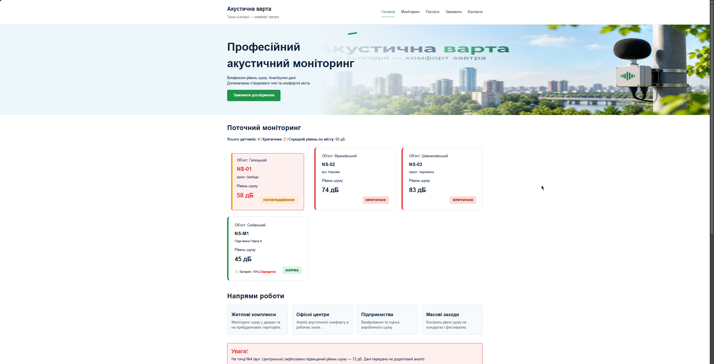

# Звіт до лабораторної роботи №5

## Тема: Проєктування системи класів у JavaScript на прикладі навчального вебпроєкту «Акустична варта».

## Мета роботи:

Навчитися переходити від набору окремих об’єктів і функцій до спроєктованої системи взаємопов’язаних класів: виділяти сутності предметної області, визначати їх стан і поведінку, розподіляти відповідальності, будувати композицію, аргументовано використовувати наслідування та інтегрувати об’єктну модель у наявний вебпроєкт.

## Виконання роботи

- здійснено рефакторинг JavaScript-коду з процедурного підходу на об'єктно-орієнтований, створено модульну архітектуру файлів (директорії `models`, `services`) та підключено головний скрипт `app.js` до HTML-сторінки як модуль (`type="module"`);
- спроєктовано систему класів із чітким розподілом відповідальностей: `NoiseMeasurement` (окреме вимірювання), `NoiseSensor` (фізичний датчик) та `MonitoringSystem` (колекція сенсорів), стан яких ініціалізується за допомогою `constructor` та ключового слова `this`;
- реалізовано композицію (система містить об'єкти датчиків, а датчики — об'єкти вимірювань), централізовано бізнес-правила класифікації шуму в константі `NOISE_LIMITS` та застосовано статичні методи (`static`) для операцій, що не потребують конкретного екземпляра;
- продемонстровано механізм наслідування за допомогою ключових слів `extends` та `super()` на прикладі підкласу `MobileNoiseSensor`, який успадковує базовий стан від `NoiseSensor` та розширює його додатковою поведінкою (моніторинг заряду батареї);
- інтегровано об'єктну модель у наявний DOM-інтерфейс: налаштовано динамічний рендеринг карток датчиків та панелі агрегованої статистики на основі викликів прототипних методів об'єктів (наприклад, `getStatus()`), суворо відокремивши логіку предметної області від логіки відображення HTML.

## Результат

Посилання на опубліковану сторінку:
https://orestforemskyi.github.io/Web-Development-KN-41/lab_5/index.html
---

Скріншот результату:

## Висновок

Під час виконання лабораторної роботи було успішно переведено архітектуру вебпроєкту на об'єктно-орієнтований підхід. Закріплено практичні навички роботи з класами в JavaScript: керування станом екземплярів, оголошення прототипних і статичних методів, реалізація композиції та наслідування. Було опановано принципи модульності (ES6 Modules) та єдиної відповідальності, що дозволило ефективно розділити бізнес-логіку обробки даних сенсорів та процеси рендерингу HTML-інтерфейсу.