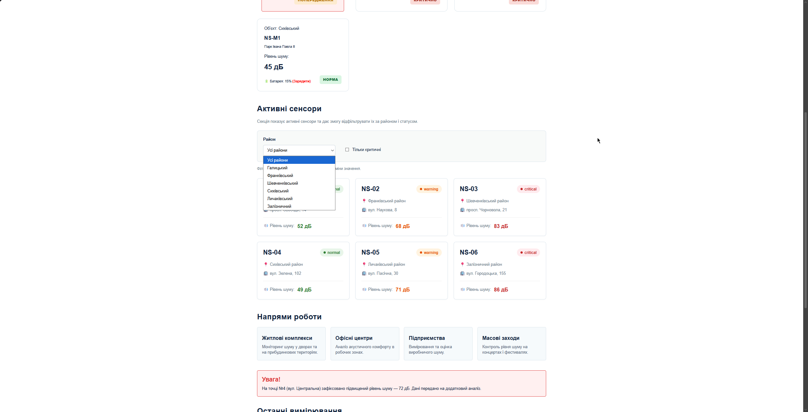

# Звіт до лабораторної роботи №6

## Тема: Відображення та фільтрація сенсорів у DOM.

## Мета роботи:

Навчитися відображати дані сенсорів на існуючій сторінці «Акустична варта» та фільтрувати їх за районом і статусом, використовуючи JavaScript для пошуку елементів у DOM, динамічного створення нових вузлів та обробки подій користувача.

## Виконання роботи

- додано нову секцію «Активні сенсори» до HTML-сторінки, що містить заголовок, контейнер для карток та панель фільтрів (випадаючий список для вибору району та чекбокс для фільтрації критичних статусів);
- отримано посилання на необхідні DOM-елементи за допомогою методу `document.querySelector()`;
- написано функцію `createSensorCard(sensor)`, яка створює HTML-елементи картки (`article`, `h3`, `p`, `span`) через `document.createElement()`, наповнює їх даними через `textContent` та додає відповідні CSS-класи (`classList.add`) залежно від статусу сенсора;
- створено функцію `renderSensors()`, яка очищує контейнер за допомогою `replaceChildren()` та додає згенеровані картки у DOM;
- реалізовано функцію `applyFilters()`, що фільтрує масив даних сенсорів за допомогою методу `filter()` на основі обраного району та стану чекбокса;
- налаштовано обробку подій через `addEventListener("change", ...)` для миттєвого оновлення списку карток при зміні параметрів фільтрації користувачем.

## Результат

Посилання на опубліковану сторінку:
https://orestforemskyi.github.io/Web-Development-KN-41/lab_6/index.html
---

Скріншот результату:

## Висновок

Під час виконання лабораторної роботи було успішно закріплено навички роботи з Document Object Model (DOM) за допомогою JavaScript. Було опановано методи пошуку елементів, динамічного створення та додавання HTML-вузлів, а також стилізації елементів шляхом маніпуляції з класами. Налагоджено механізм фільтрації масиву об'єктів та обробку подій користувача (`change`), що дозволило створити інтерактивний інтерфейс без необхідності перезавантаження сторінки.